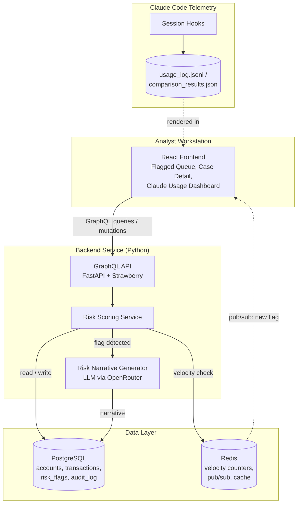
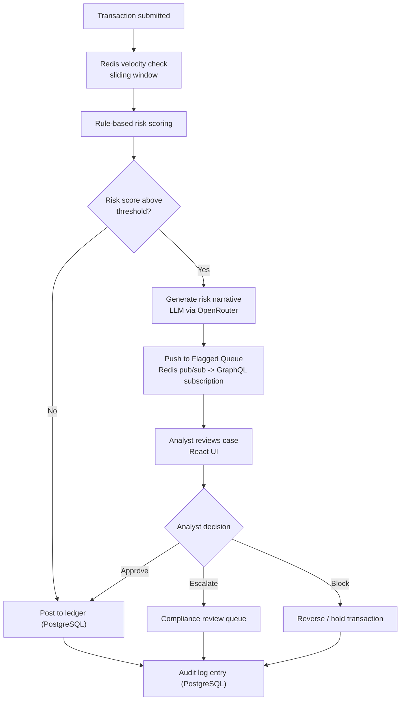

# RiskPulse — Claude Code Workshop

RiskPulse is a real-time transaction fraud & risk monitoring platform for a
retail bank. It's also the vehicle for a hands-on Claude Code workshop: the
platform is built live, one feature at a time, and this repo is both the
product and the record of how it was built — prompts, metrics and all.

## What it does

A bank's transactions stream in continuously. Most are fine. Some need a
human to look at them before money moves. RiskPulse is the system that
tells the difference:

- Every transaction gets a real-time **velocity check** (e.g. "5 transfers
  to new payees in 10 minutes") and a **rule-based risk score**.
- Anything above threshold gets an **LLM-generated risk narrative** — a
  plain-English explanation of *why* it was flagged — and lands in a
  fraud analyst's queue.
- The analyst **approves, escalates, or blocks** the transaction from a
  live dashboard. Nothing is auto-blocked without that human gate.
- Every decision is written to an immutable audit log.

A second panel in the same app tracks **how the workshop itself is going**:
token usage and cost per Claude Code prompt, and a side-by-side comparison
of models (via OpenRouter) for the risk-narrative feature — so "did this
capability actually help" is a number, not a feeling.

## Status

Only the workshop console (`ui/`) exists right now — the dark dashboard you
get from `./run.sh`, showing environment readiness and the feature roadmap.
The application architecture below is the **target**: what gets built,
feature by feature, as the workshop progresses. Check the console's
Feature Roadmap panel for what's live vs. still upcoming.

## Architecture



## Core flow: transaction risk-flagging



This flow is also the Feature 1 lab: the Draft-Review-Approve workflow with
a mandatory human-in-the-loop gate before anything gets blocked.

## Tech stack

| Layer | Choice | Why |
|---|---|---|
| Frontend | React + TypeScript + Apollo Client | GraphQL-native, real-time subscriptions for the flagged queue |
| Backend API | Python, FastAPI + Strawberry GraphQL | typed schema, async-friendly |
| Database | PostgreSQL | accounts, transactions, risk flags, audit trail |
| Cache / real-time | Redis | sliding-window velocity checks, pub/sub push to the UI |
| AI feature | LLM risk-narrative generator, multi-model via OpenRouter | compares cost/quality across models before picking one for production |
| Telemetry | Claude Code hooks -> `usage_log.jsonl` | every prompt's token/cost logged, rendered in-app |

## Repo layout

```
.
├── run.sh                    # ./run.sh -> serves the workshop console (Python stdlib only)
├── scripts/env_check.py      # probes python/node/npm/docker/git/internet
├── ui/                       # workshop console (vanilla HTML/CSS/JS, no build step)
│   ├── index.html / styles.css / app.js
│   └── data/roadmap.json     # feature roadmap, flips live -> done as we go
├── prompt-library/schema.md  # before/after logging format used in every lab
├── backend/                  # FastAPI + GraphQL service (built from Feature 8)
├── frontend/                 # React app (built from Feature 8)
└── README.md
```

## Requirements

- **Python 3.9+** — runs the workshop console now, and the backend from
  Feature 8 on
- **git** — to pull each feature as it's pushed
- **Node.js 18+** and **Docker** — not needed yet; required starting
  Feature 8 (GraphQL backend, PostgreSQL, Redis). The console's
  Environment Readiness panel tells you the moment you're missing one.

## Setup

```bash
git clone https://github.com/patilanirudh/claude_code.git riskpulse
cd riskpulse

# create a virtual environment -- keeps workshop deps isolated from system Python
python3 -m venv .venv

# activate it
source .venv/bin/activate        # macOS / Linux
# .venv\Scripts\Activate.ps1     # Windows PowerShell
# .venv\Scripts\activate.bat     # Windows cmd.exe

# install Python dependencies (empty for now -- grows as backend features land)
pip install -r requirements.txt
```

## Run it

The console itself only needs Python's standard library — no venv or
installs required just to see it:

```bash
./run.sh
```

Starts a local server and opens the workshop console at
`http://localhost:8787`. On a remote VM, forward that port or browse to
`http://<vm-ip>:8787` directly — the script prints both.

## During the workshop

Before each feature block:

```bash
git pull
./run.sh
```

Everything we build — the actual RiskPulse app code, the prompts used to
build it, and the metrics on how well each Claude Code capability performed
— lands in this same repo as we go.
